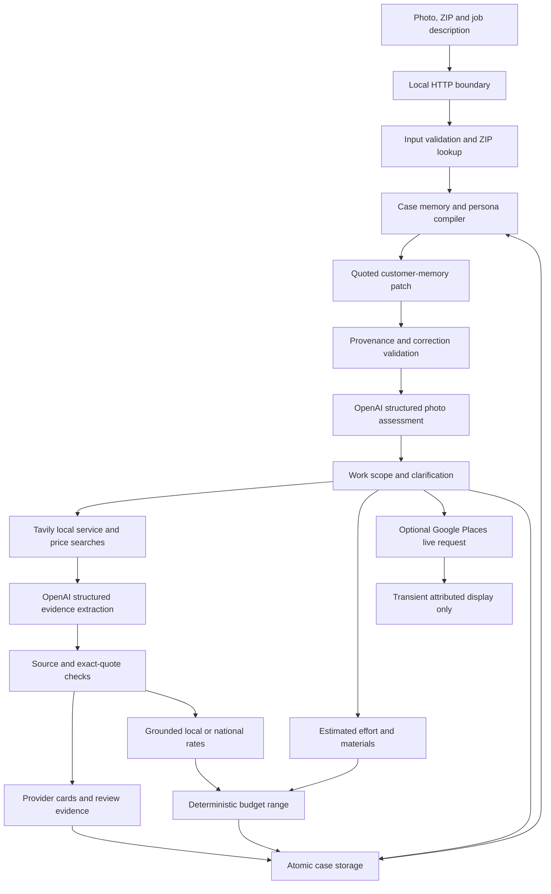

# Architecture: Home Repair Advisor v0.4.0

Implemented October 11, 2026; memory extension October 12, 2026. The owner approved the Home Repair Advisor concept and authorized API connection and testing. This document describes running code, with future work explicitly separated.

## Data flow

The orchestrator owns this bounded workflow. Models do not execute shell commands, alter persona files, choose arbitrary API endpoints, book services or send messages. The initial use case needs image understanding and structured extraction, so the implementation uses the Responses API directly with `store: false`. Hosted execution sandboxes and an autonomous agent loop are unnecessary for this bounded path.

## Boundaries

| Module | Responsibility | State/authority |
|---|---|---|
| `persona/identity.json` | Stable role, values and communication style | Owner-authored version changes |
| `prompts/*.md` | Task and evidence rules | Code-reviewed authored changes |
| `src/advisor.mjs` | Case transitions and prompt compilation | May update case, never identity |
| `src/memory.mjs` | Typed, quoted customer facts and job epochs | Validated patches; no assistant or website write authority |
| `src/schema.mjs` | Structured contracts and runtime validation | Rejects malformed output |
| `src/providers/openai.mjs` | OpenAI transport and output parsing | No local tools or implicit fallback |
| `src/providers/tavily.mjs` | Three discovery queries, up to three company review queries, ZIP lookup | Public read-only retrieval |
| `src/estimate.mjs` | Ground monetary rates and calculate ranges | Local/national provenance, no hidden ZIP multiplier |
| `src/reviews.mjs` | Profile identity checks and call ordering | Phone/domain match and attributable rating |
| `src/providers/google-places.mjs` | Optional direct business/review source | Transient display only; last recorded key check was IP-blocked |
| `src/evidence.mjs` | Source binding, quote and field checks | Drops unsupported claims |
| `src/store.mjs` | Atomic per-case files and exclusive writes | Isolates cases by session owner hash |
| `src/server.mjs` | HTTP validation, session isolation and limits | Loopback only |
| `public/` | Intake, results and user-controlled contact actions | No API secrets |

## Case state and continuity

A case holds an immutable ID, owner hash, timestamps, revision, resolved location, current images, transcript, latest assessment, latest report, retrieved source text and request traces. Identity version is separate from mutable job state. Each trace records provider/model, response ID, elapsed time, usage and prompt version/hash where available.

A successful follow-up increments the revision and invalidates the old report. A changed ZIP is resolved again. New attached images replace the prior set; omitting images retains them for the same job. An explicit job replacement clears them. A failed model request leaves the saved case unchanged. Same-case overlapping updates and stale revisions return 409. The current limits are three images, 2 MB per image after preprocessing, 4,000 message characters, 20 turns, 40 mutation requests per hour, two concurrent mutations and 60 model calls per server process. These are development limits, not commercial quotas.

Active source-quoted facts plus the recent 16 transcript messages enter assessment; the prior assessment is excluded. A separate memory writer proposes changes grounded in customer messages. Job replacement clears earlier facts, photos and contextual exchanges. The full transcript and supersession journal remain local. Identity version and hash prevent silent canon changes. See [memory and persona continuity](MEMORY_AND_PERSONA.md) for migration, validation, limits and research applicability. Restarting the server retains cases; model changes still require behavioral evaluation.

## API

All JSON mutations require `Content-Type: application/json` and `X-Persona-Client: 1`. Browser requests must come from the same local origin. The browser receives an HttpOnly SameSite=Strict session cookie. The JSON API is version 0.1 and internal to this prototype.

| Method and path | Input | Result |
|---|---|---|
| `GET /api/health` | None | Configuration presence, model and persona metadata, no secrets |
| `POST /api/cases` | `zip`, `message`, optional image data URLs | New assessed case and session cookie |
| `GET /api/cases/:id` | Session cookie | Own case, excluding owner hash and full source pages |
| `POST /api/cases/:id/messages` | `revision`, `message`, optional `zip`, optional images | Updated assessment and invalidated old report |
| `POST /api/cases/:id/search` | `revision`, optional `force: true` | Source-checked local options and estimate and review evidence |
| `DELETE /api/cases/:id` | Session cookie and client header | Removal of that local case |

A repeated search may reuse a report for five minutes. Explicit refresh bypasses that cache. ZIP coverage and appointments are always marked as needing confirmation in this version. No booking endpoint exists.

## Provider portability

The orchestrator consumes `structured({instructions, input, schema, name})` and receives `{data, trace}`. An additional provider adapter must translate the current text/image message representation, enforce the same schema, handle refusal and incomplete responses, and return compatible metadata. The profile, case store and UI stay independent of API session IDs.

Only OpenAI is implemented and live-tested now. Unknown provider IDs produce an explicit error. There is no silent OpenRouter or Anthropic fallback. Before enabling another provider, run the same cases and compare job correctness, persona style, uncertainty, evidence attribution, cost and latency. Portability of files does not prove identical behavior.

## Evidence checks and limits

Search returns up to 21 public URL records across service, cost and review queries (individual review lookups can return the same URL with a fresh source ID). Each retained source has an ID, URL, title, text, retrieval time and a page-extract/search-excerpt label. Evidence extraction cannot introduce a new source ID. Quotes must match returned text after whitespace and typographic normalization. Claim values must appear in their quotes; phone digits and rating/count values receive additional checks. Profile pages must contain the provider name. Browser rendering uses text nodes and approved HTTP links, never raw model HTML.

These checks reduce invented fields but do not prove semantic entity matching, website honesty, current prices or contractor competence. Exact ZIP coverage and appointment availability require stronger integrations. The local URL filter is a display/source filter, not a general network sandbox; the application does not fetch arbitrary supplied URLs itself.

## Next engineering work

1. Resolve the Google key IP restriction through an explicitly authorized configuration change or an already permitted deployment host. Public platform profiles remain the working review route.
2. Evaluate rate applicability, quantities, material allowances and entity matching against human-reviewed cases. The calculation model is implemented but not calibrated against completed invoices.
3. Integrate actual availability only through a supported scheduling source, keeping retrieval and confirmation timestamps.
4. Add account authentication, case history, retention controls, idempotency and durable multi-process concurrency before hosted multi-user deployment.
5. Add a second model adapter and behavioral migration tests, then consider voice if needed.

## Budget and review extension

See [methodology](ESTIMATES_AND_REVIEWS.md). Assessment adds `estimatePlan`; evidence adds `costRates` and review samples. A bounded optional enrichment pass searches existing companies by name. The server grounds rates and computes totals without asking the model to do arithmetic. Reports identify version 1.1.0. Older assessments acquire the new plan on explicit refresh. Failed web retrieval does not replace a saved report unless the independent directory returns useful results. Failed review enrichment retains the successful estimate/provider step and shows a warning. Google ratings, reviews and names are excluded from disk even if a caller passes them to the case store.

## Release tooling, October 14, 2026

Standard startup reads the environment without an owner key-file dependency. The optional owner wrapper preserves local convenience. Complete cold snapshot/restore tooling copies validated case files into a new directory; see [data and recovery](DATA.md). The release has no public hosting or account-recovery claim.

## Language revision, October 14, 2026

Conversation instructions support American English and Brazilian Portuguese, following an explicit preference or the current conversation. Source quotations and transcripts remain verbatim. Internal specifications, identifiers and development history are English; customer-facing generated prose follows the conversation. Browser labels and code-generated status/estimate labels remain English.

Prompt 1.3.0 keeps trade/searchTerms in English for US lookup and renders original assessment and evidence explanations in the customer language. Only the exact prior authored identity hash is accepted for the language-only revision; other identity changes remain rejected. Existing cases receive the new identity fingerprint on successful reassessment.

## External-memory revision, October 15, 2026

App 0.4.0 loads an authored `persona/memory-policy.json` alongside its character definition. The application owns persistent identity and experience; the model receives a compiled context without any weight updates. See [persona definition](PERSONA.md) and [external-memory implementation](EXTERNAL_MEMORY.md). Original evidence is selected independently of fact extraction, with scope filtering before ranking, source hashes and unknown-validity annotations. The component budget measures serialized UTF-8 bytes, not model tokens.
