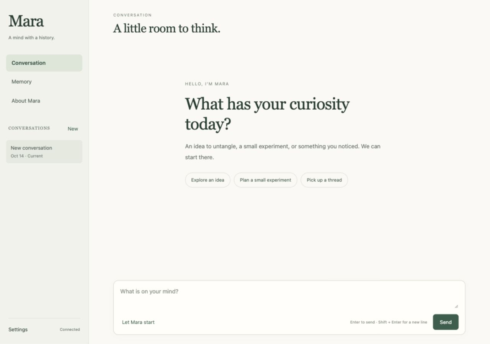

# Mara

**A mind with a history.**

[Português brasileiro](README.pt-BR.md) · [User guide](docs/USER_GUIDE.md) · [Architecture](docs/ARCHITECTURE.md) · [Release notes](CHANGELOG.md)

Mara is a conversational character who remembers what you discuss and develops habits and views through experience. She likes small inventions, practical experiments, and the detail that changes an explanation. She can follow a thread across conversations, reconsider an unsuccessful approach, and return to an earlier version of herself while keeping her history.

Talk with her in English or Brazilian Portuguese. Conversations, memories, and development history live in a local SQLite database.




The persona persists in application-owned external state, while the configured model enacts it. This version adds independent recall of original messages with source provenance. [Persona and memory](docs/PERSONA.md).

## What you can do

- **Have a conversation.** Explore an idea, describe an experience, or let Mara choose a topic.
- **Pick up a thread.** Reopen earlier conversations and search their original messages and summaries.
- **See her develop.** Follow emerging views and habits, their supporting experiences, and changes over time.
- **Reconsider an approach.** Repeated unsuccessful outcomes can retire a habit; one isolated setback does not.
- **Keep your history.** Back up the database, restore it to a new location, or compare independent Mara profiles.

## Run locally

Install Node.js 24 or later. There are no npm dependencies or build step.

```sh
cp .env.example .env
```

Add your OpenAI API key to `.env`, then start:

```sh
npm start
```

Open [Mara](http://127.0.0.1:4351). An existing exported `OPENAI_API_KEY` also works. Your API account handles model usage. Choose an available Responses API model through `MARA_MODEL` before creating a profile; existing profiles keep their original model.

Memory search works immediately using keywords. Optional local multilingual embeddings add semantic matching: see [setup and configuration](docs/SETUP.md).

## The interface

**Conversation** is the main workspace. **Memory** provides summaries, search, and links to original messages. **About Mara** shows her current self and development history. **Settings** contains the connection, request limit, conversation identity, and advanced profile controls.

The initial request limit is 60. To inspect it or deliberately set a new total without losing history:

```sh
npm run budget
npm run budget -- --limit 200
```

## Where to go next

- [User guide](docs/USER_GUIDE.md): conversations, memory, habits, and earlier versions.
- [Setup](docs/SETUP.md): model configuration, optional semantic search, and troubleshooting.
- [Data and backups](docs/DATA.md): persistence, restoration, and what leaves the computer.
- [Architecture](docs/ARCHITECTURE.md): layers, contracts, learning, and runtime boundaries.
- [Development](docs/DEVELOPMENT.md): implementation history and evidence.
- [Roadmap](ROADMAP.md): planned improvements.
- [Contributing](CONTRIBUTING.md): working on the code and reporting issues.

Mara currently runs as a text application for one local operator. Responses arrive as complete messages. Hosting, voice, external actions, and account authentication are future work. Model generation uses the configured API; local embeddings do not make conversation generation offline.

## License

[MIT](LICENSE). Copyright (c) 2026 Denis Ostapenko. See [licensing and distribution](docs/LICENSING.md) and [third-party notices](THIRD_PARTY_NOTICES.md).
