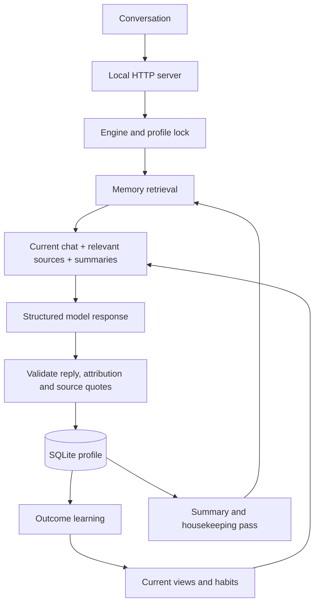

# Mara architecture 0.3.0

Reviewed October 14, 2026. The production entrypoint is `src/server.mjs`: Node.js 24, built-in SQLite, the OpenAI Responses API, and a vanilla JavaScript browser interface. Optional Python embeddings run locally. Each profile is a complete independent trajectory in one SQLite row.

## Components

| Component | Responsibility |
| --- | --- |
| `public/` | Conversation, archived chats, memory search, self/history views, settings |
| `src/server.mjs` | Loopback HTTP transport, request validation, maintenance timer |
| `src/engine.mjs` | Per-profile serialization, dialogue, evidence intake, sessions, rollback |
| `src/learning.mjs` | Provisional rules, prospective outcomes, beliefs, habit adoption/retirement |
| `src/memory.mjs` | Working context, summaries, conversation overviews, themes, retrieval |
| `src/embeddings.mjs` | Local worker lifecycle, embedding cache and fallback |
| `src/provider.mjs` | Structured model requests, persistent attempt accounting, no automatic retry |
| `src/store.mjs` | Profiles, immutable origin checks, revisions, SQLite ledger |
| `src/contracts.mjs` | Output schemas, exact types, identifiers and validation |
| `scripts/` | Snapshots, request limits, optional embedding preparation and verification |

## State and authority

`origin` contains the authored self, model, reasoning setting and original operational envelope. `originHash` is checked when a profile loads and against the stored configuration on save. `current` is Mara's present self. Versions and change records preserve previous states; restoring a version appends a new version.

The live adaptive path updates habits and opinions through outcome learning. Self-description, interests and dispositions remain represented but are not autonomously rewritten by this path. The older proposal/reviewer engine remains available for historical experiments and deterministic comparisons; it is not the web server's learning mode.

Mood has two bounded channels, tension and interest. Relationships are keyed by conversation partner. These are separate from persistent self changes. Event attribution identifies the actor, affected party and relationship target; a third party's conduct must not mechanically become a penalty against the narrator. Attribution is interpreted by the model and then validated structurally.

Profiles are independent. Partner identities within a profile scope raw conversation retrieval; the profile's self and learned rules are shared across its experiences. Partner IDs are not authenticated accounts.

## A dialogue turn

1. Validate the identifier and message; acquire the profile's in-process lock.
2. Load the current state and establish its active session. Ordinary profiles have runtime limits of 10,000 episodes, 10,000 turns and 1,000 initiatives. Synthetic profiles retain the smaller original envelope.
3. Compile eight recent turns from the active conversation, ranked memories, source excerpts and two preceding conversation overviews. Add the current self, learned rules and this partner's pending action trials.
4. Ask the configured model for a reply, attributed event, optional decision, explicit outcome feedback and initial beliefs when none have been seeded.
5. Validate the schema and exact quotations. A short message can create a turn without an evidence episode. Feedback must refer to a recorded trial for the same partner. Unknown signals are omitted.
6. Record the turn, episode, action prediction and observed feedback with optimistic revision checking.
7. Run eligible rule discovery and a bounded memory pass. The saved reply survives a later background error, which is returned separately.

Replies follow English or Brazilian Portuguese. Interpretations, summaries, reasons and predictions are requested in English; exact source quotations retain their language. Language is prompted, not enforced by a linguistic classifier.

## Hierarchical memory

| Layer | Contents | Lifetime |
| --- | --- | --- |
| Working context | Latest eight turns in the active session | Recompiled each turn |
| Original episodes | Attributed incoming text, reply, source hash, timestamps and session | Retained |
| Segment summaries | Up to twelve source episodes per batch with exact references | Derived and rebuildable |
| Conversation overviews | Summaries grouped by session | Derived |
| Themes | Projects, people, preferences, commitments, places, procedures, open questions, archive | Derived |

A summary pass becomes eligible after eight unsummarized episodes, at session closure, or on explicit maintenance. The model produces short source-backed items. References must match original text; conflict links must remain within the same partner's sources. Deduplication removes duplicate summary batches. Theme consolidation bounds recent items within each category without deleting original episodes.

Retrieval combines lexical relevance, optional 384-dimensional local multilingual embeddings, a small recency term and a redundancy penalty. It searches original episodes as well as summaries and themes. Previous conversation overviews support continuity; source excerpts take precedence when interpreting corrections and conflicts.

Derived memory selection allows 10,000 characters of complete records. Original evidence uses a separate 32,000-byte serialized-envelope budget and at most twelve whole messages. The latest eight working turns retain their full text. These are component budgets, not an exact token prediction or a total request cap. Retrieval currently scans documents and uses SQLite to cache embeddings; it is not an approximate-nearest-neighbor index.

The local embedding worker uses FastEmbed 0.8.0 and `paraphrase-multilingual-MiniLM-L12-v2`. The app requests offline model files. Optional setup explicitly downloads them once. Missing runtime, model files, invalid vectors or worker failure cause keyword fallback. Failures do not discard original memories.

A timer checks once a minute. A profile is eligible for housekeeping roughly six hours after the last attempt, while the app is running. Each pass handles at most two batches. Synthetic and busy profiles are skipped. Failed attempts get the same six-hour backoff; this is not an OS scheduler.

## Outcome learning

Discovery runs after five fresh outcome receipts. A rule proposal needs three distinct original outcome sources and valid catalog contexts, actions and signals. A proposal is provisional; its discovery examples are not counted as prospective evaluation. At most eight rules are stored per profile.

An action trial records its domain, reusable task family, action, prediction, applicable rule IDs and each rule's phase identifier. Only an executed synthetic result or explicitly reported outcome can add a receipt. A trial or identical source hash cannot count twice. Other actions do not train a habit for an action Mara did not take. Summaries, praise, repeated testimony and model-generated reflection do not add independent outcomes.

A rolling twelve-observation estimate uses the rule's prior with weight two. Habit adoption requires at least eight prospective observations across at least three task families and a Wilson lower bound above 0.5. The interval uses z=1.96. These are engineering criteria for the controller, not calibrated personality measurements.

After adoption, retirement uses a separate monitoring phase: five failures among the latest six eligible attempts, across at least three task families. Acquisition successes do not delay that phase. Retirement removes the action as a default but keeps the rule and its evidence in the current context. The model may independently retry the action when the situation warrants it.

Recovery requires seven successes among the latest eight eligible attempts after retirement, again spanning at least three families. One successful retry cannot restore the habit. Late results from an earlier phase cannot be counted as fresh recovery. Phase identities include the transition's trial ID, so rollback and another retirement do not reuse the same phase. Rule IDs are never reused from retained trial/version history.

Beliefs use the rolling estimate and interval. A low interval plus a sufficient decline from the prior marks a belief reconsidered; a high lower bound marks it supported. A fixed profile records experience without applying learning changes. Rollback restores rule snapshots alongside the self while retaining trials, receipts and source history.

## Storage and operations

One JSON profile snapshot is written with an expected revision. In-process actions on the same profile are serialized. A different process can cause a revision conflict, which is refused rather than overwriting newer state. The model call may already have been spent.

The independent `calls` table reserves an API attempt in a transaction before the network call, including failed and interrupted requests. The total limit persists across restart. The budget CLI changes the total explicitly and never resets usage or profile data. Every request has a 90-second timeout and 4,000-output-token maximum. There are no automatic model retries.

The snapshot command uses SQLite's backup API, including committed WAL state, and writes a checksum manifest. Restore validates integrity and origin hashes and requires a new directory. Keys are environment configuration and are not part of the database snapshot.

## HTTP surface

`GET /api/state` returns profiles, version, connection and request budget. `POST /api/create`, `/api/turn`, `/api/initiative`, `/api/session`, `/api/search`, `/api/memory`, `/api/reflect` and `/api/rollback` provide the local actions. POST bodies must be JSON and are capped at 16,000 bytes. Identifiers use a bounded lowercase format. The server binds to loopback and checks Host and Origin. Browser text is rendered with `textContent`; scripts and styles are served locally under a restrictive CSP.

This is a single-operator local service. It has no login, encrypted database, multi-process work queue, streaming transport, external tools or hosted deployment layer. Those are separate implementation tasks, not properties supplied by the model prompt.

## Review outcome

The 0.2 review simplified the interface, restored access to archived chats, added portable model configuration and optional local embedding setup, introduced explicit budget management and complete snapshots, and fixed stale evidence/rule reuse after rollback. See [development and verification](DEVELOPMENT.md) for measured results and remaining limits, and [memory references](RESEARCH.md) for the relationship to current research. Thresholds from the preceding habit-retirement experiment were preserved.

## External-memory revision, October 15, 2026

App 0.3.0 loads an authored `persona/memory-policy.json` alongside its character definition. The application owns persistent identity and experience; the model receives a compiled context without any weight updates. See [persona definition](PERSONA.md) and [external-memory implementation](EXTERNAL_MEMORY.md). Original evidence is selected independently of fact extraction, with scope filtering before ranking, source hashes and unknown-validity annotations. The component budget measures serialized UTF-8 bytes, not model tokens.

Selected source messages and working turns are no longer cut at 3,000 characters. New summaries pin original-source hashes; stale summaries and dependent themes/overviews are excluded. Legacy summaries retain quote checks. Current learning criteria and existing profile origins are unchanged. The model input no longer duplicates the evidence and working context inside the memory object.
